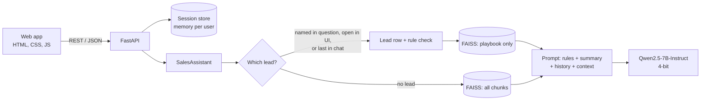

# Nova Sales Assistant: RAG + Memory for a CRM

[](https://colab.research.google.com/github/Hagar202/nova-sales-assistant/blob/main/run_in_colab.ipynb)


An AI assistant for the sales team of **Nova Digital Solutions**, a digital agency that sells websites, mobile apps, digital marketing and AI solutions.

Before calling a lead, the sales rep opens the company and gets a short brief: who they are, what they want, whether the budget is enough, and what to do next. Then they ask follow-ups like *"Is their budget enough for it?"* or *"They said the price is too high. How should I respond?"*, and the assistant remembers who "they" are.


## Features

- **Lead briefs** from a CRM sheet of 200 leads, and **sales answers** from a 5-page sales playbook (prices, discounts, payment terms, objection handling).
- **Rule-based lead check:** budget vs. package price, decision maker, Hot / Warm / Cold priority, next action and at-risk leads (no contact for more than 14 days). Calculated in Python from the playbook rules, not guessed by the model, then given to the model as context.
- **Conversation memory per user:** follow-ups (*they*, *it*) work, and two sales reps never share a chat.
- **Summary memory:** after 5 turns, the oldest 3 are summarized so long chats fit in the context window.
- **No made-up answers:** questions outside the data get *"I don't have this information."*
- **REST API** with automatic docs at `/docs`, and a web app that uses the same API.


## Architecture



1. **Data.** The playbook PDF is split into 500-character chunks with 100 overlap (29 chunks). Each lead row becomes natural sentences (200 chunks), because embedding models understand sentences better than table cells.
2. **Indexes.** `all-MiniLM-L6-v2` embeddings in two FAISS indexes: everything, and the playbook only.
3. **Retrieval.** When the lead is known, the assistant uses that exact row and searches the playbook only, so other companies' rows cannot confuse the model.
4. **Generation.** Qwen2.5-7B-Instruct in 4-bit (fits on a free T4), greedy decoding so prices come out the same every time. The model is loaded once at startup, and a lock makes requests share the GPU one at a time.

## API

| Method | Endpoint | What it does |
|---|---|---|
| GET | `/api/health` | Server and model status |
| GET | `/api/leads?priority=hot&search=nile` | List and filter leads |
| GET | `/api/leads/{lead_id}` | One lead with its rule check |
| POST | `/api/chat` | Ask a question; returns the answer, the lead it is about and the memory state |
| GET | `/api/sessions/{id}/memory` | What the assistant remembers |
| DELETE | `/api/sessions/{id}` | Clear a chat and its memory |

```bash
curl -X POST http://localhost:8000/api/chat \
  -H "Content-Type: application/json" \
  -d '{"message": "Give me a short brief about Nile Pharma before my call."}'
```


## Results

Measured in the [project notebook](notebooks/mid_project.ipynb):

| Test | Result |
|---|---|
| Factual questions (8 from the playbook, 6 from the leads) | 14 / 14 |
| Follow-up questions that need memory | 4 / 4 |
| Question outside the data | "I don't have this information." |

Plus 21 automated tests for the rules, memory and API (`pytest`).

## Run it

**Google Colab (free GPU):** click the badge above, choose **Runtime → Change runtime type → T4 GPU**, and run the cells. The last cell prints a public link to the web app.

**Locally with an NVIDIA GPU:**

```bash
git clone https://github.com/Hagar202/nova-sales-assistant.git
cd nova-sales-assistant
pip install -r requirements.txt
uvicorn app.main:app --port 8000
```

Open http://localhost:8000 for the app and http://localhost:8000/docs for the API.

**Without a GPU:** use a smaller model, or mock mode to work on the UI without any model.

```bash
LLM_MODEL=Qwen/Qwen2.5-1.5B-Instruct uvicorn app.main:app
MOCK_LLM=1 uvicorn app.main:app
```

**Docker (GPU host):**

```bash
docker build -t nova-sales-assistant .
docker run --gpus all -p 8000:8000 -v hf-cache:/models nova-sales-assistant
```

**Tests** (no GPU or model download needed):

```bash
pip install -r requirements-dev.txt
pytest
```

All settings are environment variables; see [.env.example](.env.example).

## Project structure

```
nova-sales-assistant/
├── app/
│   ├── main.py         # FastAPI app and routes
│   ├── assistant.py    # RAG, playbook rules and memory (no web code)
│   ├── llm.py          # model and embedding loading, mock model
│   ├── sessions.py     # chat memory per user, with expiry
│   ├── schemas.py      # request and response models
│   └── config.py       # settings from environment variables
├── static/             # web app: index.html, styles.css, app.js
├── tests/              # pytest: rules, memory, API
├── notebooks/
│   └── mid_project.ipynb   # original notebook with step-by-step evaluation
├── data/               # leads (.xlsx) and sales playbook (.pdf)
├── run_in_colab.ipynb  # one-click launcher for Colab
├── Dockerfile
└── requirements.txt
```

## Limitations and next steps

- **Evaluation is small** (18 questions) and checks for a keyword in the answer. Next: a larger test set and an LLM-as-judge score.
- **Sessions live in memory**, so they reset when the server restarts and do not work across several servers. Next: Redis.
- **No login.** Next: authentication, so each rep sees only their own leads.
- **One question at a time on the GPU.** Next: a serving engine such as vLLM for batching.
- Lead detection matches the company name in the text, so a misspelled name is not found.

The company and data are fictional, created for this project.

## Author

**Hagar Soliman**, AI Engineer. [LinkedIn](YOUR_LINKEDIN) | [Portfolio](YOUR_PORTFOLIO)
