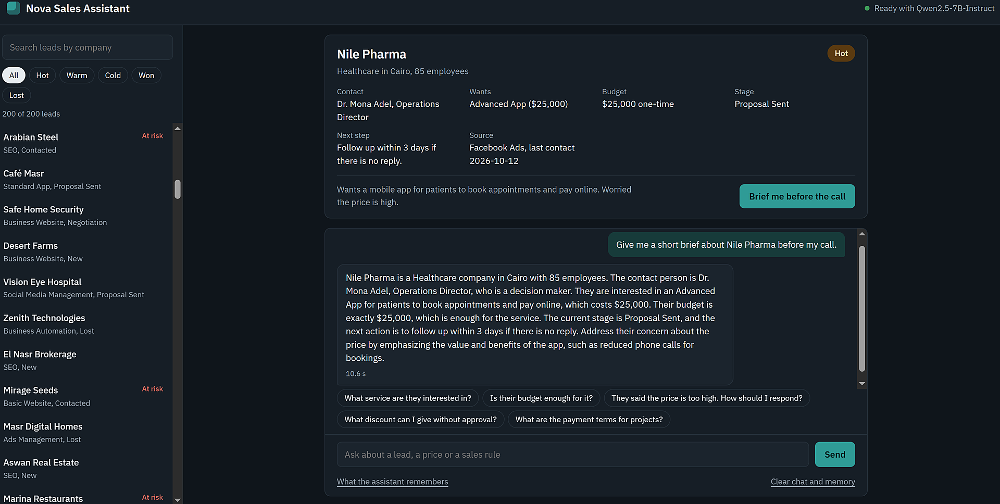
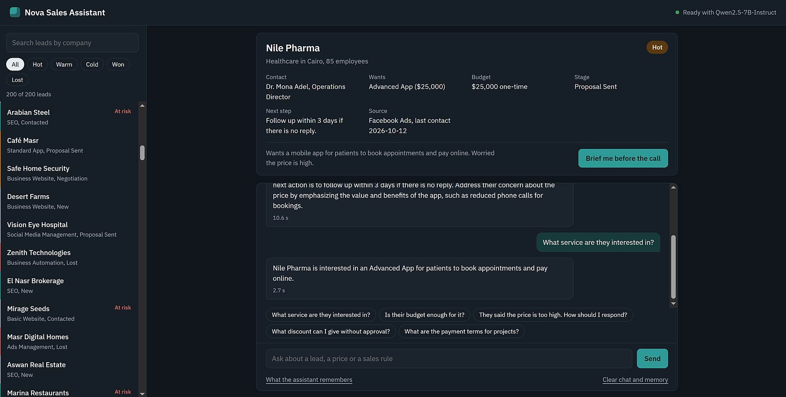
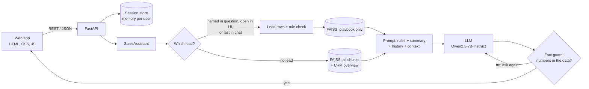
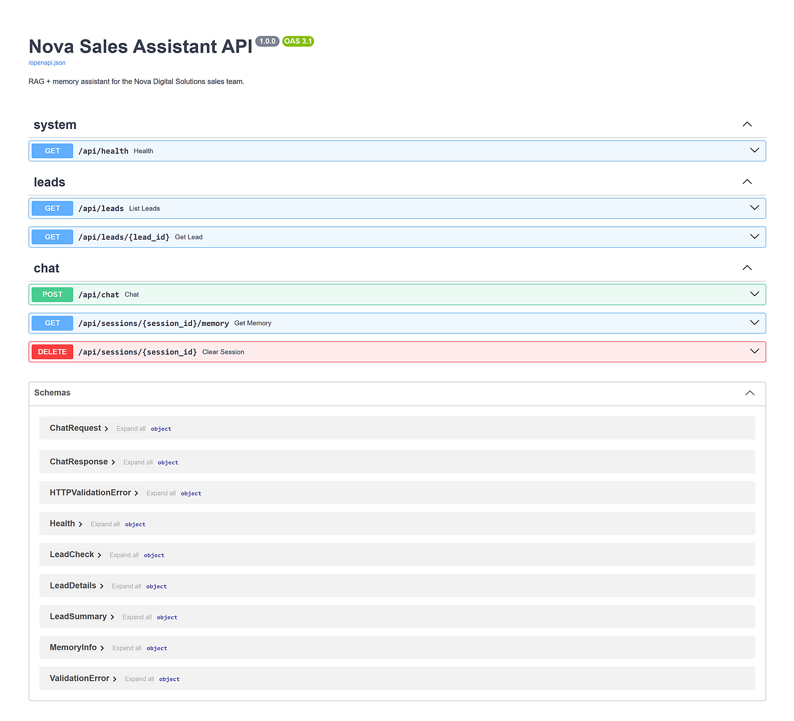

# Nova Sales Assistant: RAG + Memory for a CRM

[](https://colab.research.google.com/github/Hagar202/nova-sales-assistant/blob/main/run_in_colab.ipynb)
[](https://github.com/Hagar202/nova-sales-assistant/actions/workflows/tests.yml)


An AI assistant for the sales team of **Nova Digital Solutions**, a digital agency that sells websites, mobile apps, digital marketing and AI solutions.

Before calling a lead, the sales rep opens the company and gets a short brief: who they are, what they want, whether the budget is enough, and what to do next. Then they ask follow-ups like *"Is their budget enough for it?"* or *"They said the price is too high. How should I respond?"*, and the assistant remembers who "they" are.



## Features

- **Lead briefs** from a CRM sheet of 200 leads, and **sales answers** from a 5-page sales playbook (prices, discounts, payment terms, objection handling).
- **Rule-based lead check:** budget vs. package price, decision maker, Hot / Warm / Cold priority, next action (with the response time for each lead source) and at-risk leads (no contact for more than 14 days). Calculated in Python from the playbook rules, not guessed by the model, then given to the model as context.
- **Conversation memory per user:** follow-ups (*they*, *it*) work, and two sales reps never share a chat. Ask about two leads at once (*"Compare Nile Pharma and Sinai Tours"*) and the follow-up still knows both.
- **Summary memory:** after 5 turns, the oldest 3 are summarized so long chats fit in the context window.
- **Guards against made-up answers:**
  - questions outside the data get *"I don't have this information."*
  - every price and percentage in an answer is checked against the data. A price written next to a package must be that package's price (or a discount, a payment part or a few months of it), so *"the Basic App costs $5,000"* is caught even though $5,000 is a real price of another package. If the model writes a number the data does not support, it is asked to answer again, and if the number is still there, the UI flags it.
  - pipeline questions (*"How many hot leads do we have?"*) are answered from counts calculated in Python, never by the model counting rows.
  - every answer shows its **sources**: the CRM row and the playbook sections it used.
- **Lead names are found even when typed loosely:** any case, without accents (*cafe masr*), by Lead ID (*L001*), or with a small typo (*Nile Pharam*).
- **REST API** with automatic docs at `/docs`, and a web app that uses the same API.
- **Runs anywhere:** Qwen2.5-7B on a free Colab GPU, or on a laptop without a GPU through [Ollama](https://ollama.com).



## Architecture



1. **Data.** The playbook PDF is split into 500-character chunks with 100 overlap (29 chunks), and each chunk knows its page and section. Each lead row becomes natural sentences (200 chunks), because embedding models understand sentences better than table cells.
2. **Indexes.** `all-MiniLM-L6-v2` embeddings in two FAISS indexes (cosine similarity): everything, and the playbook only.
3. **Retrieval.** When the lead is known, the assistant uses that exact row and searches the playbook only, so other companies' rows cannot confuse the model.
4. **Generation.** Qwen2.5-7B-Instruct in 4-bit (fits on a free T4), greedy decoding so prices come out the same every time. The model is loaded once at startup, and a lock makes requests share the GPU one at a time.
5. **Checking.** The fact guard compares every `$` amount and `%` in the answer with the retrieved data.

## API

| Method | Endpoint | What it does |
|---|---|---|
| GET | `/api/health` | Server, model and data date |
| GET | `/api/leads?priority=hot&search=nile&at_risk=true` | List and filter leads |
| GET | `/api/leads/{lead_id}` | One lead with its rule check |
| POST | `/api/chat` | Ask a question; returns the answer, the leads it is about, its sources, any warnings and the memory state |
| GET | `/api/sessions/{id}/memory` | What the assistant remembers |
| DELETE | `/api/sessions/{id}` | Clear a chat and its memory |

```bash
curl -X POST http://localhost:8000/api/chat \
  -H "Content-Type: application/json" \
  -d '{"message": "Give me a short brief about Nile Pharma before my call."}'
```



## Results

Measured with Qwen2.5-7B-Instruct on a free Colab T4 in the [improved notebook](notebooks/sales_assistant_v2.ipynb):

| Test set | Result |
|---|---|
| Dev questions (30, used while writing the prompt) | 29 / 30 |
| New questions (14, written after the prompt: counting, two leads, typos, memory, out of scope) | 14 / 14 |
| Average time per answer | 3.7 s |

The one miss was a lead brief without its priority; the notebook now adds the computed priority to every brief in code, and two more checks were added for price objections and at-risk counts. The [first notebook](notebooks/mid_project.ipynb) has the original step-by-step version.

Plus 89 automated tests (`pytest`, run on every push by GitHub Actions) for the playbook rules, lead matching, memory, the fact guard and the API.

## Run it

**Google Colab (free GPU):** click the badge above, choose **Runtime → Change runtime type → T4 GPU**, then **Runtime → Run all**. Step 3 prints a public link to the web app.

**On a laptop without a GPU (Ollama):**

```bash
git clone https://github.com/Hagar202/nova-sales-assistant.git
cd nova-sales-assistant
pip install -r requirements.txt
ollama pull qwen2.5:7b-instruct
cp .env.example .env          # Windows: copy .env.example .env
# then set LLM_BACKEND=openai in .env
uvicorn app.main:app --port 8000
```

Start Ollama with a bigger context window so long prompts are not cut: `OLLAMA_CONTEXT_LENGTH=8192 ollama serve` (Windows PowerShell: `$env:OLLAMA_CONTEXT_LENGTH=8192; ollama serve`).

The same `LLM_BACKEND=openai` setting works with any OpenAI-compatible server (vLLM, Groq, OpenRouter): set `OPENAI_BASE_URL`, `OPENAI_MODEL` and `OPENAI_API_KEY`.

**With an NVIDIA GPU:**

```bash
pip install -r requirements.txt
uvicorn app.main:app --port 8000
```

Open http://localhost:8000 for the app and http://localhost:8000/docs for the API.

**Without any model** (to work on the UI): `MOCK_LLM=1 uvicorn app.main:app`

**Docker (GPU host):**

```bash
docker build -t nova-sales-assistant .
docker run --gpus all -p 8000:8000 -v hf-cache:/models nova-sales-assistant
```

**Tests** (no GPU, no torch and no model download needed):

```bash
pip install -r requirements-dev.txt
pytest
```

All settings are environment variables or a `.env` file; see [.env.example](.env.example).

**About dates:** the CRM sheet is a snapshot from 22 October 2026, so "days since contact" and "at risk" are counted from that date and the demo looks the same any day. With live CRM data, set `AS_OF_DATE=today`.

## Project structure

```
nova-sales-assistant/
├── app/
│   ├── main.py          # FastAPI app and routes
│   ├── assistant.py     # RAG, playbook rules and memory (no web code)
│   ├── guard.py         # fact guard: prices and percentages must come from the data
│   ├── vector_index.py  # FAISS index with cosine similarity
│   ├── embeddings.py    # sentence-transformers, and an offline stand-in for tests
│   ├── llm.py           # model backends: transformers, OpenAI-compatible (Ollama), mock
│   ├── sessions.py      # chat memory per user, with expiry
│   ├── schemas.py       # request and response models
│   └── config.py        # settings from environment variables
├── static/              # web app: index.html, styles.css, app.js
├── tests/               # pytest: rules, lead matching, memory, fact guard, API
├── notebooks/
│   ├── sales_assistant_v2.ipynb  # improved notebook: pandas counting, price check, evaluation
│   └── mid_project.ipynb         # first version
├── data/                # leads (.xlsx) and sales playbook (.pdf)
├── run_in_colab.ipynb   # one-click launcher for Colab
├── DEMO.md              # demo script and questions to expect
├── Dockerfile
└── requirements.txt
```

## Limitations and next steps

- **Evaluation is small** (18 questions) and checks for a keyword in the answer. Next: a larger test set and an LLM-as-judge score.
- **The fact guard checks numbers, not words.** A wrong feature is not caught, and a round amount that is not next to a package name can pass if it could be simple math on our prices. Next: check package features the same way, and an LLM-as-judge for the rest.
- **Sessions live in memory**, so they reset when the server restarts and do not work across several servers. Next: Redis.
- **No login.** Next: authentication, so each rep sees only their own leads.
- **One question at a time on the GPU.** Next: a serving engine such as vLLM for batching.
- A company name that is only partly written (*"Al Safwa"*, shared by 4 companies) is not guessed; the rep is expected to open the lead or write the full name.

The company and data are fictional, created for this project.

## Author

**Hagar Soliman**, AI Engineer. [LinkedIn](https://linkedin.com/in/hagar-soliman-0a6b41264) | [Portfolio](https://hagar202.github.io/portfolio/) | [GitHub](https://github.com/Hagar202)
